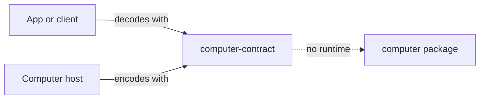

# Computer Contract (`@fungi.computer/computer-contract`)

Computer-contract is the shared definition of how to talk to a Fungi Computer:
reading and writing files, running commands, and managing processes and ports.



## Quick start

Install it:

```sh
npm install @fungi.computer/computer-contract
```

```ts
import {
  pathSchema,
  mintComputerRequestId,
} from "@fungi.computer/computer-contract";

const path = pathSchema.parse("/workspace/notes.md");
const requestId = mintComputerRequestId();
```

## Common tasks

### Check a path

`pathSchema.parse` accepts only valid Computer paths. See the Quick start.

### Mint a request ID

`mintComputerRequestId` makes the replay key a command needs. See the Quick
start.

### Look up an operation's shape

See [Core concepts](#core-concepts) and the API reference.

## Reference

### Overview

The wire contract for one Fungi Computer: the Zod schemas and types for
operation discovery, files, commands, processes and ports, shared by every host
and client that talks to a Computer. It has no runtime of its own and does not
depend on [`@fungi.computer/computer`](../computer/README.md), so an App or a
client can decode Computer operations without pulling in the Computer host.

## Install or set up

```sh
pnpm add @fungi.computer/computer-contract
```

The package is ESM-only and has one entrypoint. It depends on
`@fungi.computer/cairn` for request identifiers, `@fungi.computer/knapsack` for
the shared file-patch schemas, and `zod`.

## Core concepts

- **Operation schemas** describe each Computer operation's input and output:
  files (read, write, replace, list, patch, mkdir), command execution, processes
  and ports. A host decodes requests with them; a client decodes results with
  them.
- **Request identifiers** name one admitted operation, so repeating a request
  reads the same operation instead of running it again.
- **Backend ids** name the attached execution backend an operation ran on.

## API reference

The generated reference is in [docs/api](docs/api/README.md).

## Examples and checks

- `pnpm --filter @fungi.computer/computer-contract test` checks the reserved
  port and port-input rules.
- `pnpm --filter @fungi.computer/computer-contract stranger` packs the package
  and typechecks and runs a consumer against the tarball.

## Limits and errors

Every schema is bounded: paths, payload sizes and list lengths have explicit
limits, and a value outside them fails to decode with a Zod error. The package
performs no I/O.

## Contribute and license

Changes land through the Botanical repository. MIT licensed; see
[LICENSE](LICENSE).
